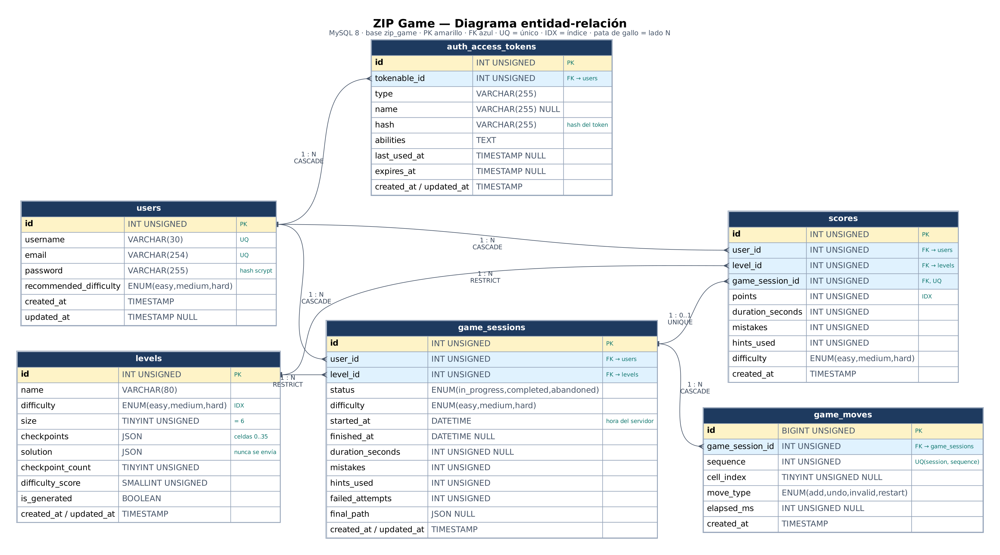
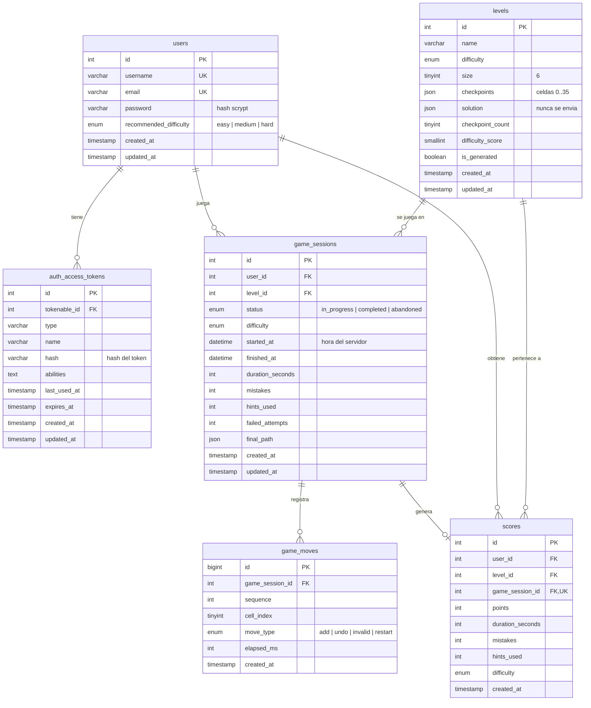

# Diagrama entidad-relación — ZIP Game

Base de datos **MySQL 8** (`zip_game`). Las tablas se crean con las migraciones de AdonisJS (`database/migrations/`), no a mano.

Archivos de este diagrama:

| Archivo | Uso |
|---|---|
| `diagrama_er.png` | Imagen para el reporte técnico |
| `diagrama_er.svg` | Versión vectorial (se puede ampliar sin perder calidad) |
| `diagrama_er.dot` | Código fuente Graphviz (`dot -Tpng diagrama_er.dot -o diagrama_er.png`) |

## Versión Mermaid (GitHub la dibuja automáticamente)

## Tablas

| Tabla | Qué guarda |
|---|---|
| `users` | Jugadores. La contraseña se guarda como hash **scrypt** y nunca se devuelve en el JSON. `recommended_difficulty` la actualiza la dificultad adaptativa. |
| `auth_access_tokens` | Tokens Bearer de sesión (expiran en 7 días). Se guarda sólo el **hash** del token, no el token. |
| `levels` | Tableros 6×6. `checkpoints` es una lista JSON con la celda de cada número en orden (celda = fila × 6 + columna). `solution` guarda el camino completo de 36 celdas; sirve para validar y dar pistas y **nunca se envía al cliente**. `difficulty_score` es la medida calculada por el generador; `is_generated` distingue los niveles de los seeders de los generados. |
| `game_sessions` | Cada partida: quién, qué nivel, estado, hora de inicio y fin **del servidor**, duración, errores, pistas, intentos fallidos y el camino final. Guarda su propia `difficulty` para que la partida no cambie aunque cambie la recomendación del jugador. |
| `game_moves` | Cada movimiento de una partida en orden (`sequence`): agregar celda, deshacer, movimiento inválido o reinicio, con el tiempo transcurrido en ms. |
| `scores` | Puntaje validado de una partida terminada, calculado sólo en el servidor. |

## Relaciones

| Relación | Cardinalidad | Al borrar el padre | Por qué |
|---|---|---|---|
| `users` → `auth_access_tokens` | 1 : N | CASCADE | Sin usuario, sus tokens no sirven. |
| `users` → `game_sessions` | 1 : N | CASCADE | Si se borra un jugador se borra su historial. |
| `levels` → `game_sessions` | 1 : N | RESTRICT | No se puede borrar un nivel que ya se jugó; se perdería el historial. |
| `game_sessions` → `game_moves` | 1 : N | CASCADE | Los movimientos sólo tienen sentido dentro de su partida. |
| `game_sessions` → `scores` | 1 : 0..1 | CASCADE | Una partida en curso no tiene puntaje; una terminada tiene exactamente uno. |
| `users` → `scores` | 1 : N | CASCADE | Igual que el historial. |
| `levels` → `scores` | 1 : N | RESTRICT | Igual que las partidas. |

## Restricciones e índices importantes

- **`scores.game_session_id` es UNIQUE.** Es la protección en la base de datos contra que una misma partida genere dos puntajes (por ejemplo, si el cliente envía *finish* dos veces). Además, el servicio bloquea la fila con `SELECT … FOR UPDATE` dentro de una transacción y responde **409** si la partida ya estaba terminada.
- **`game_moves (game_session_id, sequence)` es UNIQUE.** No puede haber dos movimientos con el mismo número de orden en una partida.
- `users.username` y `users.email` son UNIQUE (el validador también lo revisa antes de insertar).
- Índices: `levels.difficulty` (filtrar por dificultad), `game_sessions (user_id, status)` (historial y partidas en curso), `scores (user_id, level_id)` (mejor puntaje por nivel para ranking y perfil) y `scores.points`.
- `scores` repite `duration_seconds`, `mistakes`, `hints_used` y `difficulty` de la partida a propósito: el ranking y el perfil se calculan sólo con `scores`, sin unir tablas.

## Por qué JSON y celdas 0..35

El tablero siempre es 6×6, así que una celda se identifica con un solo número: `índice = fila × 6 + columna` (0 arriba a la izquierda, 35 abajo a la derecha). Con eso, los números del tablero y la solución caben en una columna JSON cada uno (`[6, 0, 1, 7, …]`), se leen completos en una consulta y el mismo formato se usa en Flutter, en la API y en la base de datos.
